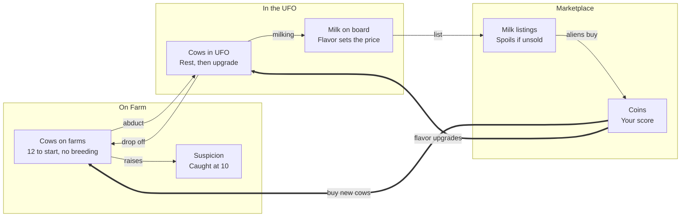

# Moo-ving Violations: Game Spec Sheet

**Group members:** Ted Roper, Porter Johnson, Gracie Jarret, Landen Schmidt, Quinn Evans

## Pitch and story

Moo-ving Violations is a single-player digital game where you pilot an alien UFO, abduct Earth cows, milk them aboard your ship, and sell the milk at the Galactic Marketplace. You spend your coins on more cows, flavor upgrades and power-ups, and try to earn the highest score you can across 10 visits without getting caught.

**Story:** Milk is the most valuable substance in the galaxy, and only Earth makes it. Each visit, you fly over the farms, beam up cows and milk them. Feed a cow the right treat and it turns into a Chocolate cow, then a Strawberry cow, and up the ladder from there, and each flavor's milk sells for more. Every abduction makes the farmers more suspicious. Push your luck too far and you're caught, losing every cow and every drop of milk on board.

**Why it's immersive:** you fly the UFO yourself, and the cows wobble as the beam lifts them. Cows change color as you upgrade them. You can watch your stocks of cows, milk, coins and suspicion rise and fall on screen, and the high-score leaderboard gives players a reason to try again with a better strategy.

## Game zones

| Zone | Stocks | What you do there | Limits |
| --- | --- | --- | --- |
| Farm (during a visit) | Cows on the farms, suspicion | Abduct cows. Drop cows back off at a farm. | Suspicion rises with every abduction. Getting caught at 10 ends the visit. |
| UFO (during a visit) | Cows in the UFO, milk on board | Upgrade a cow's flavor (costs coins). Milk rested cows. | UFO holds a limited number of cows. Cows must rest before milking. |
| Marketplace (between visits) | Milk listings, coins, cows for sale, power-ups | List milk for sale. Buy cows to drop at the farms. Buy power-ups. Let suspicion cool down. | Coins on hand. Milk spoils if it doesn't sell in time. |

## Core loop

Cows move left to right and become coins. Coins come back as new cows and flavor upgrades, so each visit can earn more than the last. Suspicion is the brake: every abduction raises it, and reaching 10 costs you everything in the UFO.

## Stocks, flows and starting values

All numbers here are placeholders for the team to tune during playtesting.

**Stocks**

| Stock | Zone | Starts at | Limit |
| --- | --- | --- | --- |
| Cows on the farms | Farm | 12 Regular cows across 4 farms | None, but no new cows appear on their own |
| Cows in the UFO | UFO | 0 | 3 (raised by the Bigger UFO power-up) |
| Milk on board | UFO | 0 gal | None |
| Milk listings | Marketplace | 0 gal | None |
| Coins | Marketplace | 50 | None. This is your score. |
| Suspicion | All | 0 | 10 = caught |
| Visits left | All | 10 | Game ends after visit 10 |
| Power-up levels | Marketplace | All at level 0 | Level 3 for now (more can be added) |

**Flows**

| Flow | Moves | Rate (placeholder) | Rule |
| --- | --- | --- | --- |
| Abduct | Farm cows → UFO | 1 cow at a time | Raises suspicion. A farmer may spot you and make you drop the cow. |
| Rest | Inside the UFO | 20 seconds after abduction | A cow must rest before it can be milked |
| Upgrade | Cow flavor → next flavor | Costs coins (see Cow flavors) | Done in the UFO, one step at a time |
| Milk | Rested cow → milk on board | 2 gal per milking | Each cow can be milked once per visit. Milk takes the cow's current flavor. |
| Drop off | UFO → farm cows | 1 cow at a time | Upgraded cows keep their new flavor on the farm |
| List | Milk on board → milk listings | All milk at once | Happens at the Marketplace after you end a visit |
| Sell | Milk listings → coins | Aliens buy at random | Coins go straight into your balance. Price is fixed per flavor. |
| Spoil | Out of milk listings | After a set number of visits | Spoiled milk can't be sold, so its value is lost |
| Buy cows | Coins → farm cows | 40 coins per Regular cow | Bought cows are dropped off at a farm on your next visit |
| Buy power-ups | Coins → power-up level | See Power-ups | Permanent once bought |
| Suspicion gain | Into suspicion | +1 per abduction, more in later visits | See Suspicion and getting caught |
| Cool-down | Out of suspicion | Falls to 0 over 30 seconds at the Marketplace | Leave early and you keep the rest |

## Cow flavors

Every abducted cow starts as Regular. You upgrade it one step at a time in the UFO, milk it for that flavor's milk, then drop it back at the farm as the new flavor. Better milk sells for more but spoils faster. The ladder is designed so we can add more flavors later.

| Flavor | Upgrades from | Upgrade cost | Milk price | Milk spoils after |
| --- | --- | --- | --- | --- |
| Regular | Starting flavor | Free | 10 coins/gal | 5 visits |
| Chocolate | Regular | 50 coins | 20 coins/gal | 4 visits |
| Strawberry (pink) | Chocolate | 120 coins | 35 coins/gal | 3 visits |
| Almond | Strawberry | 250 coins | 60 coins/gal | 2 visits |
| Donut | Almond | 500 coins | 100 coins/gal | 1 visit |

**Upgrade rules:** a cow can't skip a flavor, so Regular to Strawberry takes two upgrades. A rested cow can be upgraded and milked in the same visit, and the milk comes out as the new flavor.

## Loops, delays and constraints

The game covers every concept from class so far. The table maps each one to the mechanic that shows it.

| Course concept | Where it shows up in the game |
| --- | --- |
| Stocks | Cows on the farms, cows in the UFO, milk on board, milk listings, coins, suspicion |
| Flows | Abduct, rest, upgrade, milk, drop off, list, sell, spoil, buy cows, buy power-ups, suspicion gain and cool-down |
| Reinforcing loop: flavor engine | Coins pay for flavor upgrades, upgraded cows make pricier milk, and pricier milk brings in more coins for the next upgrade |
| Reinforcing loop: herd and ship growth | Coins buy more cows and a bigger UFO, which means more milk per visit and more coins |
| Balancing loop: suspicion | Each abduction raises suspicion. As it climbs, getting caught becomes likely, so the player ends the visit and lets it cool down. |
| Balancing loop: spoilage | Better milk is worth more but spoils faster, which limits how much expensive milk you can stockpile |
| Delays | Cows rest before milking. Aliens buy listed milk at random, so coins arrive later. Suspicion takes 30 seconds at the Marketplace to fall to 0. |
| Limits and constraints | UFO cow capacity, the suspicion cap of 10, 10 visits per game, coins on hand, and the fixed herd (cows only increase when you buy them) |
| Components and relationships | The UFO, cows, farmers, alien buyers, the Marketplace, and the rules that connect them |
| System diagram | The core loop diagram in this spec |

**The main tension:** staying longer on a visit means more cows and more milk, but every abduction pushes suspicion closer to 10. Getting caught wipes out everything in the UFO, so the player has to decide when to stop and head to the Marketplace.

## Format, visits and scoring

The game is single player (approved by our professor) and lasts 10 visits to Earth. There is no win screen: your score is the coins you have after visit 10, and players compete for the top spot on a high-score leaderboard.

**How a visit works**

1. **Fly in.** Your UFO arrives over the farms with whatever suspicion you carried over from last time.
2. **Abduct.** Hold the beam over a cow to lift it into the UFO. Each abduction raises suspicion, and a farmer may spot you and make you drop the cow.
3. **Work the UFO.** Rested cows can be upgraded (for coins) and milked. Drop cows back at any farm to free up space.
4. **End the visit.** Press End Visit whenever you choose. There is no timer during a visit.
5. **Marketplace.** The screen changes to the Marketplace. List your milk, buy cows and power-ups. Suspicion falls to 0 over 30 seconds while you're there.
6. **Next visit.** Leave whenever you're ready. If you leave before 30 seconds, you carry the leftover suspicion into the next visit.

**Suspicion and getting caught**

Suspicion runs from 0 to 10 and carries over between visits. It rises with every abduction, and the game gets harder as it goes on.

| Visits | Suspicion per abduction | Chance a farmer spots you |
| --- | --- | --- |
| 1–3 | +1 | 10% |
| 4–6 | +2 | 20% |
| 7–10 | +3 | 30% |

If a farmer spots you, the cow drops and suspicion goes up by an extra +1. If suspicion reaches 10, you're caught: you lose every cow and all the milk in the UFO, the visit ends, and you're sent straight to the Marketplace. The game keeps going, so getting caught costs you but never ends your run. Milk you already listed and coins you already earned are safe.

**Game stages**

- **Early game (visits 1–3): build the herd.** Suspicion rises slowly. Abduct freely, milk Regular cows and buy your first upgrades.
- **Mid game (visits 4–6): climb the ladder.** Suspicion rises faster. Players push cows to Chocolate and Strawberry and buy power-ups.
- **Late game (visits 7–10): high stakes.** Every abduction is risky. Players with stealth power-ups and high-flavor cows earn the most per visit.

**Strategies we expect to see**

- **Flavor climber:** keeps a few cows and upgrades them as high as possible for the most valuable milk.
- **Herd builder:** buys lots of Regular cows and a bigger UFO for steady volume.
- **Ghost:** invests in stealth early so they can stay longer on later visits.
- **Risk taker:** abducts until suspicion is close to 10 every visit, accepting the occasional loss.

## Power-ups

At the Marketplace, players can spend coins on power-ups such as a bigger UFO, a milk booster, a cloaking device and faster milking. Power-ups are permanent once bought, and each one can be upgraded through several levels. We plan to add more power-ups as development goes on.

| Power-up | What each level does | Level 1 | Level 2 | Level 3 |
| --- | --- | --- | --- | --- |
| Bigger UFO | +2 cow capacity (3 → 5 → 7 → 9) | 100 coins | 250 coins | 500 coins |
| Milk Booster | +1 gal per milking (2 → 3 → 4 → 5) | 200 coins | 450 coins | 900 coins |
| Cloaking Device | 20% less suspicion per abduction | 150 coins | 350 coins | 700 coins |
| Faster Milking | Cows rest 5 seconds less before milking (20 → 15 → 10 → 5) | 75 coins | 200 coins | 450 coins |

All costs and effects are placeholders. Level 3 is the cap for now, and more levels can be added if the numbers feel right in playtesting.

## Screens, assets, open questions and build plan

The game is digital and builds on our browser demo. It runs in a web browser, so classmates can play it on their laptops at the in-class playtest and the final production play. Ted Roper is making the art assets.

**Screens**

| Screen | What's on it |
| --- | --- |
| Farm visit | Night sky, 4 farms with cows, the UFO and its beam, farmers, suspicion meter, cows in the UFO, End Visit button |
| Marketplace | Milk listings and alien buyers, cow shop, power-up shop, coin balance, suspicion cool-down |
| Game over | Final coins and the high-score leaderboard |

**Art assets**

| Asset | Notes |
| --- | --- |
| UFO | Base ship, plus a look for each Bigger UFO level if time allows |
| Cows | One sprite per flavor: Regular, Chocolate, Strawberry (pink), Almond, Donut |
| Milk bottles | One per flavor, plus a spoiled look |
| Farmers | Idle and "spotted you" poses |
| Alien buyers | A few shopper designs for the Marketplace |
| Farm scene | Barns, fences, fields, night sky |
| UI | Suspicion meter, coin counter, power-up icons, buttons |

**Open questions for the group**

- [ ] How often do aliens buy listed milk? For example, a random sale every few seconds at the Marketplace, or a share of listings each visit.
- [ ] Does milk still on board the UFO (not yet listed) count toward spoilage?
- [ ] Where do bought cows go: straight onto a farm, or into the UFO to be dropped off on the next visit?
- [ ] Is the leaderboard saved on one computer only, or shared online?
- [ ] Final placeholder numbers: milk prices, upgrade costs, cow price, power-up costs, suspicion per abduction.

**Build plan**

- [ ] Submit this proposal by Thu Nov 5 at 11:59pm (every member submits a copy with all names)
- [ ] Week of Nov 9: playable visit loop (abduct, upgrade, milk, drop off, suspicion, getting caught)
- [ ] Week of Nov 16: Marketplace screen, cow flavors, power-ups, and the first art assets swapped in
- [ ] In-class playtest on Mon Nov 23 and Tue Nov 24, then tune numbers from feedback
- [ ] Final production play on Thu Dec 3
