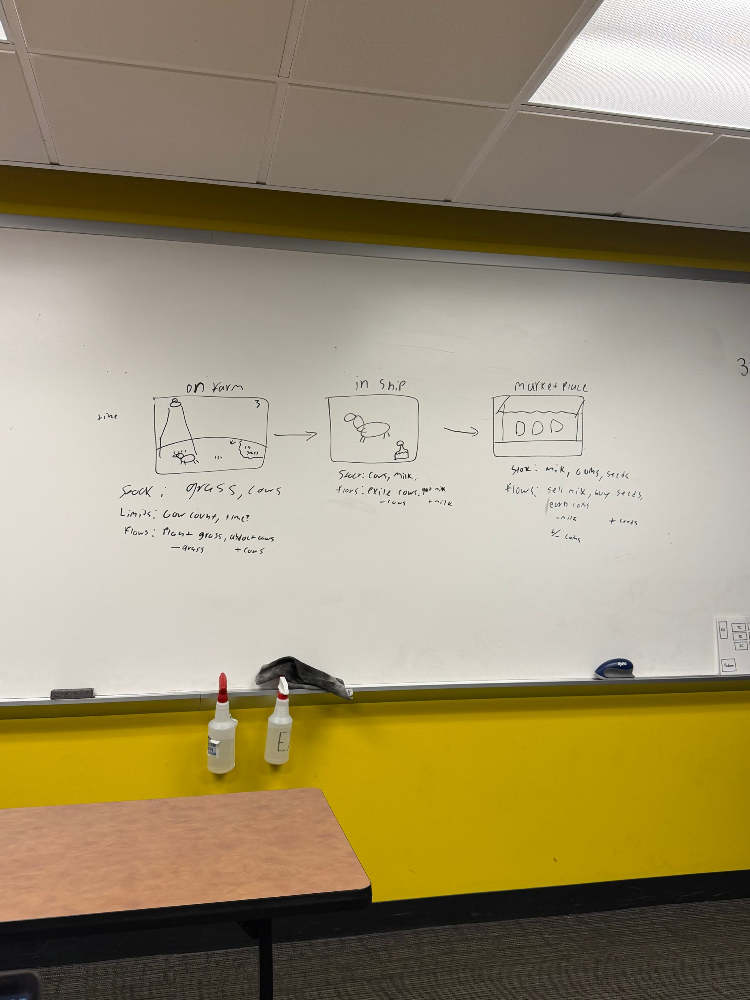
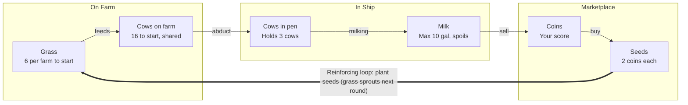

# Moo-ving Violations: Game Spec Sheet

Last updated Nov 2, 2026. The live, commentable version is the Claude doc: https://claude.ai/artifact/A9UsrixK57gcc51cuhmZVk

**Group members:** _add names here_

## Pitch and story

Moo-ving Violations is a 2–4 player tabletop game where rival alien crews abduct Earth cows, milk them aboard their saucers, and sell the milk at the Galactic Marketplace. Players spend their coins on seeds, plant grass to keep the farms full of cows, and race to become the richest crew before Earth catches on.

**Story:** Milk is the most valuable substance in the galaxy, and only Earth makes it. Each crew runs a three-step operation: abduct cows on the farm, milk them in the ship, and trade at the Marketplace. Cows only stay on farms with grass, so crews who over-abduct and under-plant end up with empty pastures.

**Why it's immersive:** each player has a saucer piece and an alien species card. Cows have names. The table is laid out as three zones that match the whiteboard (Farm, Ship, Marketplace), so players physically move tokens through the system and can see stocks rise and fall.

## Whiteboard breakdown

The whiteboard defines three zones, and each zone is its own set of stocks connected by flows. This table restates it, with the flows written as "+" (into a stock) and "−" (out of a stock).

| Zone | Stocks | Flows (in / out) | Limits |
| --- | --- | --- | --- |
| On Farm | Grass, cows | Plant grass: +grass. Cows graze: −grass. Abduct cows: −cows on the farm, +cows in the ship | Cow count (grass feeds only so many), time per round |
| In Ship | Cows, milk | Abducted cows in: +cows. Milking: +milk. Exile cows: −cows | Pen size, milk tank size |
| Marketplace | Milk, coins, seeds | Sell milk: −milk, +coins. Buy seeds: −coins, +seeds | Market price, coins on hand |

**How we read "−grass, +cows":** cows eat grass, and grass is what keeps cows on the farm and lets the herd grow. Planting grass raises the grass stock, and grazing drains it. Check this with the group (see Open questions).

## Core loop

Cows move left to right through the three zones and become coins. Coins come back around as seeds, which grow the grass that keeps cows on the farm. A player who never reinvests drains the shared herd.

## Stocks, flows and starting values

These are first-draft numbers for the playtest on 11/23. Expect to tune them after one or two test games.

**Stocks**

| Stock | Zone | Shared or per player | Starts at | Max |
| --- | --- | --- | --- | --- |
| Grass | Farm | Shared, tracked per farm (4 farms) | 6 per farm | 10 per farm |
| Cows on farm | Farm | Shared, per farm | 4 per farm (16 total) | Limited by grass |
| Cows in pen | Ship | Per player | 0 | 3 (upgradable) |
| Milk | Ship | Per player | 0 gal | 10 gal (upgradable) |
| Coins | Marketplace | Per player | 10 | None |
| Seeds | Marketplace | Per player | 2 | None |
| Action points | All | Per player, per round | 3 | 3 |

**Flows**

| Flow | Moves | Rate | Rule |
| --- | --- | --- | --- |
| Plant grass | Seeds → grass | 1 seed = +3 grass | Costs 1 action. Grass sprouts next round (delay). |
| Natural regrowth | Into grass | +1 grass per farm per round | Automatic at end of round |
| Grazing | Out of grass | −1 grass per cow per round | Automatic at end of round |
| Breeding | Into cows on farm | +1 calf per farm per round | Only if the farm has 2+ cows and grass ≥ cows |
| Wandering off | Out of cows on farm | Cows above the grass count leave | Happens when a farm runs out of grass |
| Abduct | Farm cows → pen | 1 cow per action | Roll to succeed (see Suspicion) |
| Milk | Pen cows → milk | +2 gal per rested cow | Cows rest 1 round after abduction (delay) |
| Exile | Out of pen | Cow leaves the game | Frees pen space. Optional: return it to a farm instead. |
| Sell milk | Milk → coins | Market price per gallon (starts at 3) | Price drops as more milk is sold (see Additions) |
| Buy seeds | Coins → seeds | 2 coins per seed | Costs 1 action |
| Spoilage | Out of milk | Milk older than 2 rounds spoils | Track milk age with a marker |

## Loops, delays and constraints

The game covers every concept from class so far. The table maps each one to the mechanic that shows it.

| Course concept | Where it shows up in the game |
| --- | --- |
| Stocks | Grass, cows on farm, cows in pen, milk, coins, seeds |
| Flows | Plant, graze, breed, abduct, milk, exile, sell, buy (see the flows table) |
| Reinforcing loop: profit engine | More coins buy more seeds, which grow more grass, which supports more cows, which make more milk and more coins |
| Reinforcing loop: herd growth | Cows on a well-fed farm breed calves, and more cows breed faster |
| Balancing loop: grazing | More cows eat more grass. When grass runs out, cows wander off and the herd shrinks back to what the grass can support. |
| Balancing loop: market price | Selling lots of milk drops the price, so flooding the market earns less per gallon |
| Balancing loop: suspicion | Each abduction raises suspicion, which makes the next abduction harder |
| Delays | Grass sprouts 1 round after planting. Cows rest 1 round before milking. Suspicion updates at the end of the round. The market price recovers slowly. |
| Limits and constraints | 3 action points per round (time). Pen holds 3 cows. Tank holds 10 gal. Grass caps the cow count. Coins cap what you can buy. |
| Components and relationships | Players, saucers, farms, cows, grass, the Marketplace, and the rules that connect them |
| System diagram | The core loop diagram in this spec |

**The main tension:** abducting cows is the fastest way to make money, but every cow you take is one less cow breeding on the farm. Players have to reinvest in seeds and grass, or the shared herd collapses for everyone.

## Format, rounds and winning

The game runs 10 rounds of about 3 minutes each, so a full game takes 30–40 minutes.

**Format**

- **Main mode, 2–4 player free-for-all:** each player is a rival alien crew sharing the same 4 farms.
- **Optional 3v1 mode:** one player is the Farmer. They spend their own coins on fences, guard dogs and scarecrows that make abductions harder, and they win if the herd survives with 8+ cows.

**Round structure** (each player has 3 action points per round)

1. **Farm phase:** in turn order, players spend actions. Abduct a cow (1 action, roll to succeed) or plant 1 seed on any farm (1 action).
2. **Ship phase:** milk every rested cow (free, +2 gal each). Exile any cows you no longer want (free).
3. **Marketplace phase:** sell any amount of milk at the current price (free). Buy seeds or upgrades (1 action each purchase).
4. **Earth upkeep:** new grass sprouts, cows graze, farms regrow and breed, hungry cows wander off, suspicion updates, milk ages, and the market price recovers by 1. Flip an event card for next round.

**Game stages**

- **Early game (rounds 1–3): land grab.** Farms are full and suspicion is low. Players abduct heavily and build up milk.
- **Mid game (rounds 4–7): the squeeze.** Grass is running low on popular farms, the market price is falling, and suspicion is climbing. Players who bought seeds early pull ahead.
- **Late game (rounds 8–10): cash out.** Players race to sell before the game ends. High suspicion makes every abduction risky.

**How to win**

- The player with the most coins after round 10 wins. Unsold milk and seeds are worth nothing.
- If suspicion reaches 10, the military arrives and the game ends immediately. The richest player still wins, but nobody gets a final sell phase.
- If the shared herd drops to 0 cows, every player loses.

**Strategies we expect to see**

- **Rancher:** plants a lot of grass and takes only a few cows each round. Slow, but it keeps the engine running.
- **Raider:** abducts as much as possible early and sells before the price drops.
- **Market timer:** holds milk until other players have sold and the price has recovered. Risks spoilage.
- **Free rider:** lets other players plant grass, then abducts from their farms.

## Additions beyond the whiteboard

These ideas add depth and more systems concepts. Pick the ones the group likes; the first three matter most.

**1. Suspicion meter (balancing loop + delay).** A shared track from 0 to 10. Each abduction adds +1 at the end of the round. Abduction rolls get harder as suspicion rises: on a d6 you need 2+ at suspicion 0–3, 3+ at 4–6, and 5+ at 7–9. A failed roll adds another +1. A round with no abductions at all lowers suspicion by 1.

**2. Market price that reacts (balancing loop).** The Marketplace has a price track that starts at 3 coins per gallon. Every 4 gallons sold by anyone drops the price by 1 (minimum 1). It recovers by 1 each round (maximum 5). This punishes everyone dumping milk at once.

**3. Upgrades (reinforcing loop).** Players can spend coins at the Marketplace to grow their operation.

| Upgrade | Cost | Effect |
| --- | --- | --- |
| Bigger pen | 8 coins | Pen holds 5 cows |
| Milk tank expansion | 6 coins | Tank holds 16 gal |
| Tractor beam booster | 10 coins | +1 to abduction rolls |
| Auto-milker | 12 coins | Each rested cow gives 3 gal instead of 2 |
| Cloaking device | 10 coins | Your abductions add no suspicion for 1 round (single use) |

**4. Cow types.** Draw a cow card when you abduct. Most are regular cows (2 gal). Jersey cows give 3 gal. Highland cows give 1 gal but sell to the Marketplace as "exotic" for 6 coins. A Bull gives no milk and must be exiled.

**5. Event cards (one flipped each round).**

- Full moon: abductions add +2 suspicion this round.
- Drought: no natural grass regrowth this round.
- Galactic milk shortage: milk sells for double this round.
- Seed sale: seeds cost 1 coin this round.
- Conspiracy podcast: suspicion +1.
- Crop circle craze: suspicion −1, but abduction rolls are 1 harder.
- Rainy season: every farm gets +2 grass.

**6. Alien species cards.** Each player picks a species with one perk, such as Zorblaxians (+1 action on round 1), Moolians (milk spoils after 3 rounds instead of 2) or Grassoids (seeds give +4 grass).

## Components, open questions and build plan

**Components to build**

| Item | Quantity | Notes |
| --- | --- | --- |
| Game board | 1 | Three zones: 4 farms, a ship dock per player, the Marketplace with price track and suspicion track |
| Cow tokens or minis | 30 | Toy cows, painted beads or cardboard |
| Grass tokens | 40 | Green chips or felt squares |
| Milk tokens | 40 | White chips, 1 per gallon |
| Coins | 100 | Play money or poker chips |
| Seed tokens | 20 | Small beads |
| Saucer pieces | 4 | One per player |
| Player ship mats | 4 | Pen slots, milk tank, action point tracker |
| Cow cards | 30 | If we use cow types |
| Event cards | 15 | |
| Species cards | 4–6 | |
| Six-sided dice | 4 | For abduction rolls |
| Rules sheet | 1 per player | One page |

**Open questions for the group**

- [ ] Does "−grass" mean cows eat grass (our reading), or that planting costs grass?
- [ ] What does the "3" in the corner of the farm sketch mean: 3 action points, a 3-minute timer, or 3 cows?
- [ ] Is "time" a real-time timer per round, a fixed number of rounds, or both?
- [ ] Does an exiled cow leave the game, or go back to a farm?
- [ ] Free-for-all only, or also build the 3v1 Farmer mode?
- [ ] Which additions do we keep for the first playtest?

**Build plan**

- [ ] Submit this proposal by Thu Nov 5 at 10am (every member submits a copy)
- [ ] Draw the system diagram and finalize rules: week of Nov 9
- [ ] Build a rough prototype and run one practice game inside the group: week of Nov 16
- [ ] In-class playtest on Mon Nov 23 and Tue Nov 24, then tune numbers from feedback
- [ ] Final production play on Thu Dec 3
